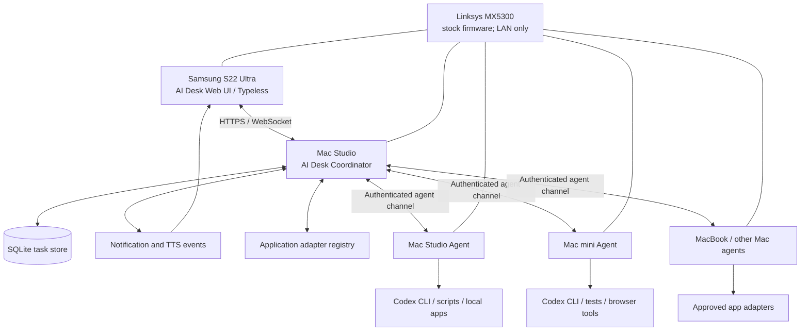

# AI Desk｜AI 总机

将闲置的 Samsung Galaxy S22 Ultra 变成多电脑 AI 工作控制台：通过 Typeless 语音输入任务，统一调度多台 Mac 上的 Codex 与其他应用，并在任务完成、失败或需要决策时通知手机、播报结果。

> **当前阶段：Mac Studio 本机真实 Codex 只读闭环已获用户终端 PASS；手机连接仍处于独立 dry-run 试验。** 正在开发的手机分支不包含真实 Codex adapter，远程任务只能模拟执行。S22 Ultra + Typeless 尚待实机验证。

## 已确定的原则

- **零新增硬件优先**：复用 S22 Ultra、现有 Mac 和 Linksys MX5300。
- **路由器不刷机**：MX5300 保持原厂固件，仅承担现有网络与 Wi-Fi 功能。
- **Mac Studio 暂任调度中心**：先打通单机闭环，之后再接入其他 Mac。
- **Typeless 负责语音输入**：第一版使用文本输入框工作流，不依赖未经确认的 Typeless API。
- **跨应用设计**：Codex 是第一种执行适配器；之后按需求增加浏览器、命令行、Blender、媒体处理等适配器。
- **先可靠后智能**：任务状态持久化、权限控制、可追踪日志和明确验收优先于复杂语音 Agent。
- **诚实报告结果**：只有任务执行器和验收条件均确认成功时才标记为成功。

## 目标架构



## 第一版（MVP）范围

1. 在 Mac Studio 启动本地调度服务。
2. 提供适合 S22 Ultra 的手机网页界面：任务输入、目标电脑选择、任务列表和详情。
3. 通过 Typeless 将语音输入转成文字；用户检查后提交。
4. 调度服务持久化任务，并调用 Mac Studio 本机的受控 Codex 适配器。
5. 把真实执行状态、结果摘要和错误反馈给手机。
6. Android 端通过通知、提示音和系统中文 TTS 汇报。
7. 具备最基本的认证、允许目录、危险操作审批和任务审计。

## 非目标（MVP 不做）

- 不刷 Linksys MX5300 固件。
- 不购买 ATA、IP 电话、录音盒或其他专用硬件。
- 不要求路由器运行自定义服务。
- 不假设 Typeless 提供公开 API、后台唤醒或自动化控制能力。
- 不通过任意命令字符串开放无限制远程 shell。
- 不自动执行未授权的删除、外部发布、部署、购买或账号权限变更。
- 不承诺手机在任何 Android 省电设置下都能保证后台通知；需在真实设备上测试。

## 研发路线

| 阶段 | 交付 | 验收重点 |
|---|---|---|
| 0. 规格与安全边界 | 本仓库设计文档、接口草案、验收清单 | 范围与风险明确 |
| 1. 单机闭环 | 手机 UI + Mac Studio coordinator + Codex adapter | 提交、执行、真实状态、结果通知 |
| 2. 稳定性 | SQLite 持久化、重启恢复、日志、权限 | 不丢任务、不伪报成功 |
| 3. 多电脑 | macOS agent 注册、心跳、任务分派 | 在线状态、排队、断线恢复 |
| 4. 多应用 | adapter registry 与首批应用适配器 | 每种适配器单独验收 |
| 5. Android 强化 | PWA 评估结果后决定是否原生封装 | 锁屏通知、TTS、后台行为 |

详细计划见 [docs/ROADMAP.md](docs/ROADMAP.md)。

## 本地运行（dry-run）

要求：Python 3.11 或更新版本，无第三方 Python 依赖。

在仓库根目录执行：

```sh
sh scripts/run-local.sh
```

脚本会生成临时 bearer token 并打印到终端，复制该 token 后在同一台 Mac 上打开 `http://127.0.0.1:8765`，输入令牌后即可提交 dry-run 测试任务。数据默认保存在 `data/ai-desk.sqlite3`。

默认只绑定 `127.0.0.1`，所以手机不能直接访问这个地址。要启用 LAN 访问，服务要求强 token 和 TLS 证书/私钥；客户端必须信任该证书。不要把明文 HTTP 暴露到整个 LAN 或互联网。当前 UI 在页面前台可使用浏览器语音合成；后台通知尚未实现。

运行测试：

```sh
PYTHONPATH=server python3 -m unittest discover -s tests -v
PYTHONPATH=server python3 -m compileall -q server tests
```

当前 dry-run 是模拟执行，用于验证任务存储与 UI，不是 Codex 执行器。

## 手机联调分支（仅 dry-run）

此分支 `feat/phone-dry-run-tailnet` 新增：
- 强制的 `phone-dry-run` 服务执行 Profile，仅允许 dry-run，禁止通过手机和代理执行 Codex。
- 独立 `127.0.0.1:8766` 启动脚本、强随机令牌和手机实验数据库。
- 手机界面检查服务模式及适配器能力后才允许提交任务；提交失败时保留文本和幂等键。
- Tailscale Serve 私有 HTTPS 联调说明、脱敏的准备检查脚本。
- 后台禁执行回归测试、HTTP 测试和前端动态测试。

**测试及实机状态：** Mac Studio 本机 Codex 只读执行已通过用户终端回报，但它在**独立的 [PR #2](https://github.com/foxmuldery/ai-desk/pull/2)**，没有开放给手机。本手机分支为 [PR #6](https://github.com/foxmuldery/ai-desk/pull/6) 草稿，S22 Ultra 尚未联调。

开始手机准备前先阅读：[S22 Ultra 私有 HTTPS + dry-run 验收指南](docs/PHONE_TAILNET_TEST.md)。

## 当前实现状态

主分支已有可运行 dry-run Coordinator、SQLite、队列、认证与手机网页。独立 Codex 只读 PR 已在 Mac Studio 上通过本机测试；手机安全连接及后台通知仍待验收。详见 [docs/DEV_STATUS.md](docs/DEV_STATUS.md)。

## 文档索引

- [S22 Ultra 安全手机联调（仅模拟执行）](docs/PHONE_TAILNET_TEST.md)
- [当前开发状态与 CI 证据](docs/DEV_STATUS.md)
- [系统架构](docs/ARCHITECTURE.md)
- [研发路线与里程碑](docs/ROADMAP.md)
- [API 草案](docs/API.md)
- [Android / S22 Ultra 交互方案](docs/ANDROID_CLIENT.md)
- [Mac 执行代理](docs/MAC_AGENT.md)
- [应用适配器设计](docs/APP_ADAPTERS.md)
- [安全与权限](docs/SECURITY.md)
- [测试与验收清单](docs/ACCEPTANCE_TESTS.md)
- [Work / Codex Desktop 交接说明](docs/HANDOFF.md)

## 当前设备与假设

- 手机：Samsung Galaxy S22 Ultra（Android 版本待现场确认）。
- 语音输入：已安装 Typeless；通过系统键盘工作流输入文本。
- 网络：Linksys Velop MX5300，明确保持原厂固件。
- 调度主机：Mac Studio（macOS 版本、固定地址与现有运行环境待确认）。
- 执行节点：Mac Studio 优先；其他 Mac 的实际型号、主机名、项目路径、权限待登记。
- Codex：需在目标 Mac 上确认实际 CLI/SDK 安装方式和允许的执行模式后实现适配器。

## 开发状态

已完成 Python Coordinator 的开发和模拟任务自动化测试，并已取得 Mac Studio 真正 Codex 只读任务与 Coordinator 本机联调成功的终端证据。仍未完成：S22 Ultra 的私有 HTTPS 联调、Typeless 实机确认、后台通知和多电脑测试。对每项能力均以真实验收结果而不是代码存在作为完成依据。

## 安全提示

默认只在 `127.0.0.1` 提供本机服务，不得暴露到公网；`phone-dry-run` Profile 禁用所有真实执行器，Tailscale Serve 仅为手机实验提供私有 HTTPS 入口。服务仍要求强随机令牌、目录 ID 和审计。真实 Codex 不允许通过此手机入口执行。
